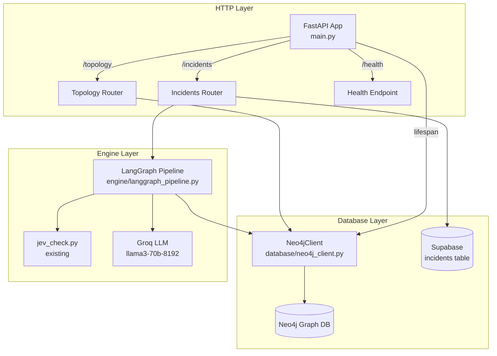
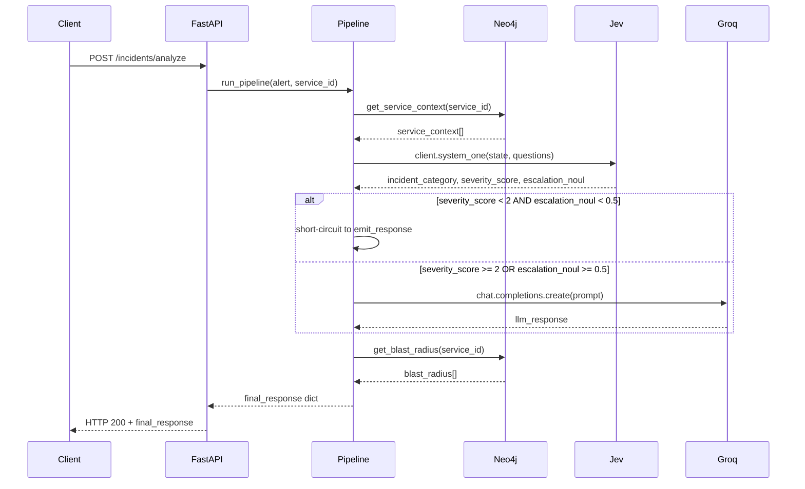
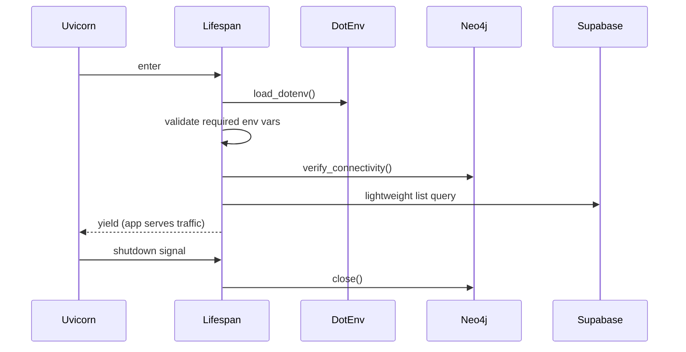

# Design Document: AegisFlow Backend Core

## Overview

AegisFlow Backend Core establishes the foundational infrastructure for the autonomous incident response platform. The implementation delivers three tightly integrated layers:

1. **Neo4j Graph Client** (`backend/database/neo4j_client.py`) — a singleton-managed driver with bi-temporal edge modeling for service dependency graphs.
2. **FastAPI Application** (`backend/main.py`) — the HTTP entry point with lifespan-managed external connections, CORS, and two domain routers.
3. **LangGraph Reasoning Pipeline** (`backend/engine/langgraph_pipeline.py`) — the dual-engine StateGraph that gates deterministic Jev scoring (System 1) against Groq LLM reasoning (System 2) to triage incidents.

The design is constrained to the pinned dependency set in `backend/requirements.txt` and accounts for existing code in `backend/engine/jev_check.py` (fully implemented), which the pipeline imports without modification.

---

## Architecture



### Request Flow — Incident Analysis



### Application Startup Sequence



---

## Components and Interfaces

### Module Layout

```
backend/
  database/
    __init__.py
    neo4j_client.py        # Neo4jClient class + get_neo4j_client() singleton factory
  engine/
    __init__.py            # existing — no changes
    jev_check.py           # existing — no changes
    langgraph_pipeline.py  # new: LangGraph StateGraph pipeline
  routers/
    __init__.py
    topology.py            # POST /topology/ingest
    incidents.py           # POST /incidents/, GET /incidents/{id}, POST /incidents/analyze
  main.py                  # FastAPI app instance + lifespan context manager
```

### `Neo4jClient` — `backend/database/neo4j_client.py`

```python
class Neo4jClient:
    def __init__(self) -> None: ...
    def close(self) -> None: ...
    def verify_connectivity(self) -> bool: ...
    async def __aenter__(self) -> "Neo4jClient": ...
    async def __aexit__(self, *args) -> None: ...
    def upsert_service_dependency(
        self,
        service_id: str,
        service_name: str,
        external_system: str,
        protocol: str = "HTTPS",
    ) -> None: ...
    def get_blast_radius(
        self, failed_service_id: str, max_hops: int = 3
    ) -> list[dict]: ...
    def get_service_context(self, service_id: str) -> list[dict]: ...

# Module-level singleton
_client: Neo4jClient | None = None

def get_neo4j_client() -> Neo4jClient: ...
```

**Initialization contract**: `__init__` reads `NEO4J_URI`, `NEO4J_USER`, and `NEO4J_PASSWORD` from the environment. If any is absent or empty, it raises `RuntimeError` before constructing the driver. This keeps the error site at import-time/first-use rather than at query time.

**Singleton contract**: `get_neo4j_client()` initializes `_client` on first call and returns it on all subsequent calls. It is designed to be passed as a FastAPI `Depends` dependency.

### `IncidentState` TypedDict — `backend/engine/langgraph_pipeline.py`

```python
class IncidentState(TypedDict):
    alert: str
    service_id: str
    service_context: list[dict]
    jev_results: dict          # keys: incident_category, severity_score, escalation_noul
    llm_response: str          # empty string when skipped (not None)
    final_response: dict
```

**Pipeline nodes**:

| Node | Inputs read | Outputs written |
|---|---|---|
| `enrich_with_graph` | `service_id` | `service_context` |
| `jev_gate` | `alert`, `service_context` | `jev_results` |
| `llm_reason` | `alert`, `service_context`, `jev_results` | `llm_response` |
| `emit_response` | `jev_results`, `llm_response`, `service_id` | `final_response` |

**Conditional routing** from `jev_gate`:

```python
def route_after_jev(state: IncidentState) -> str:
    r = state["jev_results"]
    if r["severity_score"] < 2 and r["escalation_noul"] < 0.5:
        return "emit_response"
    return "llm_reason"
```

### FastAPI Pydantic Models

```python
# routers/topology.py
class TopologyIngestRequest(BaseModel):
    service_id: str
    service_name: str
    external_system: str
    protocol: str = "HTTPS"

class TopologyIngestResponse(BaseModel):
    message: str

# routers/incidents.py
class IncidentCreateRequest(BaseModel):
    service_id: str
    alert: str
    metadata: dict = {}

class IncidentAnalyzeRequest(BaseModel):
    service_id: str
    alert: str

class IncidentResponse(BaseModel):
    id: str
    service_id: str
    alert: str
    metadata: dict
    created_at: str

# main.py
class HealthResponse(BaseModel):
    neo4j: dict   # {"healthy": bool}
    supabase: dict  # {"healthy": bool}
```

---

## Data Models

### Neo4j Graph Schema

```
(:Service {id: str, name: str, created_at: datetime})
  -[:DEPENDS_ON {valid_from: datetime, valid_to: datetime|null, protocol: str}]->
(:ExternalSystem {name: str})
```

**Bi-temporal edge semantics**:
- `valid_to IS NULL` → edge is currently active
- `valid_to IS NOT NULL` → edge is expired (historical record)
- Upsert pattern: close the existing active edge, then create a new one. This preserves the full history of dependency changes.

**Blast radius traversal**:
```cypher
MATCH path = (:Service {id: $service_id})-[:DEPENDS_ON*1..$max_hops]->(target)
WHERE ALL(r IN relationships(path) WHERE r.valid_to IS NULL)
RETURN DISTINCT target
```

**Service context query** (direct neighbors only):
```cypher
MATCH (:Service {id: $service_id})-[r:DEPENDS_ON]->(target)
WHERE r.valid_to IS NULL
RETURN target.name AS name, labels(target)[0] AS type, r.protocol AS protocol
```

**Cypher style rules** (enforced by requirement 2.6):
- Comments use `//` syntax, not `--`
- Relationship literals close with `}->`, not `]->` or `-->`

### Supabase Schema

Table: `incidents`

| Column | Type | Notes |
|---|---|---|
| `id` | uuid | primary key, auto-generated |
| `service_id` | text | foreign reference (not constrained) |
| `alert` | text | raw incident alert text |
| `metadata` | jsonb | arbitrary caller-supplied context |
| `created_at` | timestamptz | auto-set by Supabase |

The Supabase client is initialized in `routers/incidents.py` from `NEXT_PUBLIC_SUPABASE_URL` and `NEXT_PUBLIC_SUPABASE_PUBLISHABLE_KEY`. It is not shared with other modules.

### Environment Variables

| Variable | Consumer | Required |
|---|---|---|
| `NEO4J_URI` | `Neo4jClient` | Yes |
| `NEO4J_USER` | `Neo4jClient` | Yes |
| `NEO4J_PASSWORD` | `Neo4jClient` | Yes |
| `GROQ_API_KEY` | `langgraph_pipeline.py` | Yes |
| `NEXT_PUBLIC_SUPABASE_URL` | `routers/incidents.py` | Yes |
| `NEXT_PUBLIC_SUPABASE_PUBLISHABLE_KEY` | `routers/incidents.py` | Yes |
| `CORS_ALLOW_ORIGINS` | `main.py` | No (defaults to `["*"]`) |
| `TYPESAFE_API_KEY` / `JEV_API_KEY` | `jev_check.py` (existing) | Yes |

---

## Correctness Properties

*A property is a characteristic or behavior that should hold true across all valid executions of a system — essentially, a formal statement about what the system should do. Properties serve as the bridge between human-readable specifications and machine-verifiable correctness guarantees.*

### Property 1: Missing environment variables always raise RuntimeError

*For any* subset of `{NEO4J_URI, NEO4J_USER, NEO4J_PASSWORD}` where at least one variable is absent or empty, constructing `Neo4jClient` SHALL raise a `RuntimeError` before any driver is created.

**Validates: Requirements 1.2**

---

### Property 2: get_neo4j_client() always returns the same singleton

*For any* number of successive calls to `get_neo4j_client()` within the same process, all calls SHALL return the identical object instance.

**Validates: Requirements 1.7**

---

### Property 3: Blast radius only contains active-edge descendants

*For any* service graph containing a mix of active (`valid_to IS NULL`) and expired (`valid_to IS NOT NULL`) DEPENDS_ON edges, `get_blast_radius()` SHALL return only nodes reachable exclusively through active edges, and SHALL never return nodes reachable only through expired edges.

**Validates: Requirements 3.3**

---

### Property 4: Blast radius result set is unique

*For any* service graph, the list returned by `get_blast_radius()` SHALL contain no duplicate node records (uniqueness by node `id`), regardless of how many distinct paths lead to the same node.

**Validates: Requirements 3.4**

---

### Property 5: Service context only contains active-edge neighbors

*For any* `Service` node with a mix of active and expired DEPENDS_ON edges, `get_service_context()` SHALL return only the direct neighbors connected via active edges, and SHALL never include neighbors reachable only through expired edges.

**Validates: Requirements 4.2**

---

### Property 6: Service context records always contain required fields

*For any* service with active DEPENDS_ON relationships, every dict in the list returned by `get_service_context()` SHALL contain the keys `name`, `type`, and `protocol`.

**Validates: Requirements 4.3**

---

### Property 7: Missing required env vars always abort startup

*For any* subset of the six required environment variables (`NEO4J_URI`, `NEO4J_USER`, `NEO4J_PASSWORD`, `GROQ_API_KEY`, `NEXT_PUBLIC_SUPABASE_URL`, `NEXT_PUBLIC_SUPABASE_PUBLISHABLE_KEY`) where at least one is absent, the lifespan startup sequence SHALL abort without yielding and SHALL not serve traffic.

**Validates: Requirements 5.5**

---

### Property 8: Valid topology ingest payload always returns HTTP 200

*For any* `TopologyIngestRequest` with non-empty `service_id`, `service_name`, and `external_system`, `POST /topology/ingest` SHALL return HTTP 200.

**Validates: Requirements 6.2**

---

### Property 9: Incomplete topology payload always returns HTTP 422

*For any* request body to `POST /topology/ingest` that omits one or more required fields (`service_id`, `service_name`, `external_system`), the endpoint SHALL return HTTP 422 with Pydantic validation error details.

**Validates: Requirements 6.3**

---

### Property 10: Routing decision is a pure function of severity_score and escalation_noul

*For any* pair `(severity_score: int, escalation_noul: float)`, the pipeline routing decision SHALL be:
- `emit_response` if and only if `severity_score < 2 AND escalation_noul < 0.5`
- `llm_reason` if and only if `severity_score >= 2 OR escalation_noul >= 0.5`

This property must hold for all valid combinations including boundary values (`severity_score = 2`, `escalation_noul = 0.5`).

**Validates: Requirements 8.3, 8.4**

---

### Property 11: LLM prompt always contains all required context fields

*For any* pipeline state with non-empty `alert`, `service_context`, and populated `jev_results`, the prompt constructed in `llm_reason` SHALL contain the alert text, service context, `incident_category`, severity label (Low/Moderate/High/Critical), and `escalation_noul` value.

**Validates: Requirements 9.2**

---

### Property 12: final_response always contains all required keys

*For any* completed pipeline execution (whether via short-circuit or full LLM path), the `final_response` dict SHALL contain the keys `incident_category`, `severity`, `needs_escalation`, `llm_reasoning`, and `blast_radius`.

**Validates: Requirements 10.1**

---

### Property 13: needs_escalation is true if and only if escalation_noul >= 0.5

*For any* pipeline execution, `final_response["needs_escalation"]` SHALL equal `True` if and only if the `escalation_noul` stored in `jev_results` is greater than or equal to `0.5`.

**Validates: Requirements 10.1**

---

## Error Handling

### Neo4j Client

| Failure | Behavior |
|---|---|
| Missing env var at init | `RuntimeError("Missing required env var: {VAR_NAME}")` raised before driver construction |
| `driver.verify_connectivity()` raises | Caught and re-raised as `ConnectionError` with original cause in message |
| Query execution error | Propagated from the `neo4j` driver as-is; callers handle at the router/pipeline level |
| `close()` called when driver not initialized | No-op (guard with `if self.driver`) |

### FastAPI / Lifespan

| Failure | Behavior |
|---|---|
| Missing env var at startup | Log descriptive error identifying the missing variable; raise `RuntimeError` to abort startup |
| Neo4j unreachable at startup | `verify_connectivity()` raises `ConnectionError`; lifespan propagates it, Uvicorn aborts |
| Supabase unreachable at startup | Log error and abort; prevents serving traffic with broken Supabase |
| Pydantic validation failure | FastAPI returns HTTP 422 automatically with field-level error details |
| `GET /incidents/{id}` not found | Incidents router returns HTTP 404 |

### LangGraph Pipeline

| Failure | Behavior |
|---|---|
| `GROQ_API_KEY` absent | `RuntimeError` raised before constructing the Groq client |
| Jev API exception | Error propagated; pipeline does not fall through to `llm_reason` |
| `get_service_context()` returns `[]` | Pipeline continues; `service_context` set to `[]` |
| Groq API exception | Propagated to the caller (HTTP 500 from the incidents router) |

---

## Testing Strategy

### Framework

- **Unit/property tests**: `pytest` with `hypothesis` for property-based testing
- **HTTP integration tests**: `httpx.AsyncClient` via `pytest-asyncio` with FastAPI's `TestClient`
- **Mocking**: `unittest.mock.patch` / `pytest-mock` for Neo4j driver, Supabase client, Jev client, and Groq client

### Dual Testing Approach

**Unit/example tests** cover:
- `Neo4jClient.__init__` reads correct env vars (example)
- `verify_connectivity()` returns `True` on success (mocked driver)
- `close()` delegates to `driver.close()` (mocked)
- Async context manager protocol (`__aenter__`/`__aexit__`)
- Lifespan startup calls `load_dotenv`, `verify_connectivity`, Supabase check in order
- `GET /health` returns correct JSON shape
- `GET /incidents/{id}` returns 404 for unknown IDs
- `jev_gate` stores all three fields in `jev_results` (mocked Jev)
- `llm_reason` stores LLM text in `llm_response` (mocked Groq)
- `GROQ_API_KEY` absent raises `RuntimeError`

**Property-based tests** (via `hypothesis`) cover Properties 1–13 above. Each test is configured for a minimum of 100 iterations. Test tags use the format:

```
Feature: aegisflow-backend-core, Property {N}: {property_text}
```

### Property Test Configuration

```python
# Example tag format for each property test
@settings(max_examples=100)
@given(...)
def test_property_N_title(...)
    # Feature: aegisflow-backend-core, Property N: <text>
    ...
```

### Key Mocking Strategy

| Component | Mock approach |
|---|---|
| `neo4j.GraphDatabase.driver` | `patch("neo4j.GraphDatabase.driver")` returning a `MagicMock` |
| Supabase client | `patch("supabase.create_client")` |
| `TypeSafeClient` | `patch("engine.jev_check.TypeSafeClient")` |
| `groq.Groq` | `patch("engine.langgraph_pipeline.groq.Groq")` |
| Environment variables | `monkeypatch.setenv` / `monkeypatch.delenv` from `pytest` fixtures |

### What is NOT property-tested

- FastAPI lifespan and app startup (side-effect-only, `SMOKE`)
- Supabase read/write operations (external service, `INTEGRATION`)
- Neo4j Cypher query syntax correctness (structural, verified by integration tests against a real or test Neo4j instance)
- CORS middleware configuration (structural, `EXAMPLE`)
